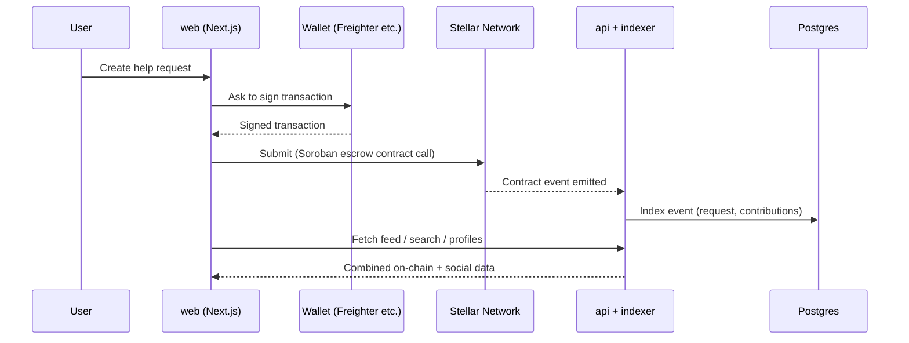

<div align="center">

# 🌍 StellarAid-network

**A decentralized social network for giveaways, help requests, and community-driven mutual aid, built on the Stellar blockchain.**

[Website](https://stellaraid.example) · [Docs](https://docs.stellaraid.example) · [Discord](https://discord.gg/your-invite) · [Twitter/X](https://x.com/stellaraid)


</div>

---

## Table of contents

1. [Why StellarAid](#why-stellaraid)
2. [What you can do](#what-you-can-do)
3. [How it works](#how-it-works)
4. [Repositories](#repositories)
5. [Architecture](#architecture)
6. [Trust and safety](#trust-and-safety)
7. [Quick start (full stack, local)](#quick-start-full-stack-local)
8. [Roadmap](#roadmap)
9. [Governance and decision making](#governance-and-decision-making)
10. [Contributing](#contributing)
11. [Security](#security)
12. [Community and support](#community-and-support)
13. [License](#license)

---

## Why StellarAid

Mutual aid works when people can help each other quickly, directly, and transparently. Today, most community giving runs through platforms that take large fees, hold funds for days, restrict who can receive money, and give donors little visibility into where money goes.

Stellar is a good fit for fixing this:

| Property | Why it matters for mutual aid |
|---|---|
| Fees of a fraction of a cent | Small gifts (even $1) are not eaten by fees |
| About 5 second settlement | Help arrives while it is still needed |
| Stablecoins (USDC) on-chain | Value does not swing between pledge and payout |
| Anchors (SEP-24) | People can cash in and out through local currency (for example Nigerian Naira) |
| Native claimable balances | Giveaways without writing custom contract code |
| Soroban smart contracts | Escrow, funding goals, and refunds with public, auditable rules |

**Our principle:** money and rules live on-chain, where anyone can verify them. Social content (posts, comments, search) lives off-chain, where it is cheap and fast, and is anchored to the chain by content hashes where verifiability matters.

---

## What you can do

### 🎁 Giveaways
Lock funds for others to claim. Supported modes:
- **First come, first served**: the first N verified claimers receive a share.
- **Time-boxed**: funds are claimable only inside a window, and unclaimed funds return to the creator.
- **Task-based** *(planned)*: claimers complete a task, verified by the creator or the community.
- **Random draw** *(planned)*: winners picked via a verifiable randomness scheme.

### 🙏 Help requests
Post a need with a funding goal and a deadline.
- Contributions are held in a **Soroban escrow contract**.
- If the goal is not met by the deadline, **contributors are refunded**.
- Funds can be released **in milestones**, confirmed by the community or by attestors.

### 💬 Social layer
Profiles, a public feed, comments, follows, and reputation, so you can see who is behind a request and how they have behaved before.

### 🛡 Trust layer
Verified-need attestations, reputation badges, community flagging, and full on-chain contribution history.

---

## How it works



1. Users connect a **Stellar wallet**. No passwords and no accounts to create.
2. Anything involving money is a **signed Stellar transaction**, so the user stays in control of their keys.
3. The **indexer** reads on-chain events and mirrors them into a database, so the feed and search are fast.
4. The **API** serves social data (profiles, comments, reports) and verifies wallet identity using SEP-10.

---

## Repositories

| Repo | Purpose | Stack | Status |
|---|---|---|---|
| [`contracts`](https://github.com/StellarAid-network/contracts) | Soroban smart contracts: help-request escrow, reputation, attestations. Source of truth for on-chain rules. | Rust, Soroban, Stellar CLI | 🚧 In development |
| [`sdk`](https://github.com/StellarAid-network/sdk) | TypeScript SDK: generated contract bindings, claimable-balance builders, SEP-10 helpers, shared types and network config. Published to npm. | TypeScript | 🚧 In development |
| [`web`](https://github.com/StellarAid-network/web) | The user-facing app: wallet connect, giveaways, help requests, profiles, feed. | Next.js, TypeScript, Tailwind | 🚧 In development |
| [`api`](https://github.com/StellarAid-network/api) | Off-chain backend: profiles, posts, comments, reports, search, SEP-10 auth, plus the indexer worker. | Node.js, Fastify, Postgres, Prisma | 📋 Planned |

### Dependency flow

```
contracts ──► sdk ──► web
                │      │
                └──► api
```

- `contracts` is the **source of truth**. Each release generates TypeScript bindings that are published through `sdk`.
- `web` and `api` **never import from each other**. They share code only through `sdk`.
- Contract addresses are published per network in `sdk` (`deployments`), so every service reads the same values.

---

## Architecture

```
┌──────────────────────────┐
│  Browser (web)           │
│  Next.js + Wallets Kit   │
└───────┬──────────┬───────┘
        │          │
        │ signed   │ REST / OpenAPI
        │ txs      │
        ▼          ▼
┌───────────────┐  ┌───────────────────────────┐
│ Stellar       │  │ api                       │
│ Horizon +     │  │ Fastify · SEP-10 · Prisma │
│ Soroban RPC   │  │                           │
│               │  │ ┌───────────────────────┐ │
│ ┌───────────┐ │  │ │ indexer worker        │ │
│ │ contracts │─┼──┼►│ events → Postgres     │ │
│ └───────────┘ │  │ └───────────────────────┘ │
└───────────────┘  └─────────────┬─────────────┘
                                 ▼
                            Postgres
                  IPFS (media, referenced by hash)
```

### What lives where

| Data | Location | Reason |
|---|---|---|
| Funds, escrow, goals, refunds | Stellar (Soroban / native) | Trustless and auditable |
| Giveaway locks and claims | Stellar claimable balances | Native, no custom code |
| Reputation scores, attestations | Stellar (Soroban) | Tamper-resistant |
| Posts, comments, profiles, follows | Postgres | Cheap, searchable |
| Images and attachments | IPFS (hash in DB or on-chain) | Content-addressed, verifiable |
| Reports and moderation state | Postgres | Needs fast human-in-the-loop workflow |

---

## Trust and safety

Open giving attracts scammers and bots. We treat this as a first-class design problem.

- **Sybil resistance**: minimum account age, reputation thresholds, optional refundable deposits, and optional phone or social verification on claims.
- **Escrow by default**: help-request funds are locked in a contract, not sent straight to the requester.
- **Milestone release**: larger requests release funds in stages after confirmation.
- **Transparent ledger**: every contribution and payout is publicly visible on-chain.
- **Community flagging**: users can report suspicious content. Moderators can hide content in the off-chain layer, but **cannot move or freeze funds**.
- **Verified-need attestations**: trusted third parties (community leaders, charities) can attest that a request is genuine.

> ⚠️ **No system eliminates fraud.** Contribute to people and causes you trust, and read the [Safety guide](https://docs.stellaraid.example/safety).

---

## Quick start (full stack, local)

**Prerequisites:** Node.js 20+, pnpm 9+, Rust (stable) with the `wasm32v1-none` or `wasm32-unknown-unknown` target as required by your Stellar CLI version, Stellar CLI, Docker, and Git.

```bash
# 1. Clone everything side by side
mkdir stellar-aid && cd stellar-aid
for r in contracts sdk web api; do git clone https://github.com/stellar-aid/$r.git; done

# 2. Build and test the contracts
cd contracts && stellar contract build && cargo test && cd ..

# 3. Build the SDK
cd sdk && pnpm install && pnpm build && pnpm link --global && cd ..

# 4. Start the API (Postgres via Docker) and the indexer
cd api && cp .env.example .env && docker compose up -d db \
  && pnpm install && pnpm prisma migrate dev && pnpm dev && cd ..

# 5. Start the web app
cd web && cp .env.example .env.local && pnpm install \
  && pnpm link --global @stellar-aid/sdk && pnpm dev
```

Open <http://localhost:3000>, install the [Freighter](https://www.freighter.app/) wallet, switch it to **Testnet**, and fund your account with [Friendbot](https://lab.stellar.org/account/fund).

Each repo's README has the full details and troubleshooting.

---

## Roadmap

| Phase | Scope | Status |
|---|---|---|
| **1. Foundation (testnet)** | Wallet connect, profiles, basic feed, direct tipping and donations | 🚧 |
| **2. Giveaways** | Claimable-balance giveaways (first come, time-limited), claim flow with anti-bot checks | 📋 |
| **3. Help requests** | Soroban escrow with goal, deadline, refunds, and progress UI | 📋 |
| **4. Trust layer** | On-chain reputation and badges, reporting, verified-need attestations | 📋 |
| **5. Mainnet and anchors** | Contract audit, SEP-24 fiat on/off-ramps, mainnet launch | 📋 |
| **Later** | Mobile app, task-based and random-draw giveaways, localization, DAO governance | 💡 |

Track progress on the [org project board](https://github.com/orgs/stellar-aid/projects/1).

---

## Governance and decision making

- **Maintainers** review and merge changes within their repo.
- **Cross-repo changes** (for example a contract ABI change) are proposed as an **RFC** in the [`.github`](https://github.com/stellar-aid/.github) repo under `rfcs/`, then implemented in coordinated PRs.
- **Breaking contract changes** require a major version bump of `contracts` and `sdk`, plus a migration note.
- Releases follow **semantic versioning** across `contracts` and `sdk`.
- Long-term, we intend to move parameter and treasury decisions toward community governance.

---

## Contributing

We welcome contributions of all kinds: code, docs, design, translation, testing, and community moderation.

1. Read the [Contributing guide](https://github.com/stellar-aid/.github/blob/main/CONTRIBUTING.md) and the [Code of Conduct](https://github.com/stellar-aid/.github/blob/main/CODE_OF_CONDUCT.md).
2. Pick an issue labeled `good first issue` or `help wanted` in any repo.
3. Comment on the issue so others know you are working on it.
4. Open a PR following the repo's template. Use [Conventional Commits](https://www.conventionalcommits.org/) (`feat:`, `fix:`, `docs:`).

**Cross-repo work tip:** open linked PRs, merge `contracts` first, then `sdk`, then `web` / `api`.

---

## Security

**Never open a public issue for a vulnerability.**

- Email **security@stellaraid.example**, or use GitHub's private vulnerability reporting on the affected repo.
- Include reproduction steps, impact, and affected versions.
- We aim to acknowledge reports within **72 hours**.
- Contracts will be independently audited before any mainnet deployment. Audit reports will be published in the `contracts` repo.
- A bug bounty program will launch alongside mainnet.

Details: [SECURITY.md](https://github.com/stellar-aid/.github/blob/main/SECURITY.md).

---

## Community and support

- 💬 **Discord**: questions, ideas, and live help
- 🐛 **GitHub Issues**: bugs and feature requests (in the relevant repo)
- 🗣 **GitHub Discussions**: design conversations and RFC feedback
- 📣 **Announcements**: follow us on X for release news

---

## License

Unless a repo states otherwise, StellarAid projects are released under the **MIT License**. See the `LICENSE` file in each repository.

---

<div align="center">
Built with care for communities that take care of each other. 💛
</div>
